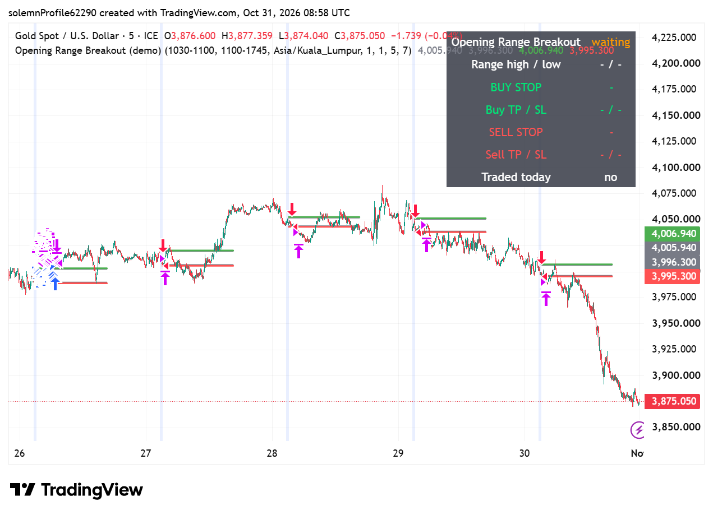

# Opening Range Breakout — TradingView Strategy (Pine Script v5)

A small, readable **intraday breakout strategy** for TradingView that can be **back-tested** in the Strategy Tester.

## How it works
1. **Opening range** — the high and low of a session you choose (default `10:30–11:00`).
2. **Orders** — a **buy stop** at range high **+ offset** and a **sell stop** at range low **− offset** (default 1 pt).
3. **Exits** — fixed **take profit** and **stop loss** in points (default TP 5 / SL 7), separately for buy and sell.
4. **One trade per day** — when one side fills, the other order is cancelled (OCO).
5. **End of window** — open orders are cancelled and any position is closed at the end of the trading window.
6. **Levels table** — range high/low, buy stop, sell stop and their TP/SL are shown in the **top-right corner** of the chart.

## Inputs
| Input | Default | Meaning |
|---|---|---|
| Opening range | `1030-1100` | session used for the high/low |
| Trading window | `1100-1745` | entries allowed; flat at its end |
| Timezone | `Asia/Kuala_Lumpur` | any IANA zone, e.g. `America/New_York` |
| Point size | `1.0` | price units per 1 pt (set to tick size for FX) |
| Entry offset | `1` | pts above/below the range |
| Take profit / Stop loss | `5` / `7` | pts |
| Only one trade per day | on | OCO behaviour |

## Use it
1. TradingView → **Pine Editor** → *Create new → Strategy*.
2. Paste `OpeningRangeBreakout.pine`, **Save**, **Add to chart**.
3. Use a timeframe **smaller than the opening range** (e.g. 1m–15m for a 30-minute range).
4. Open **Strategy Tester** for the back-test report.

Works on any symbol (futures, gold, indices, FX); just set the session times, timezone and point size.

## Disclaimer
Educational demo. Not financial advice. Past back-test results do not guarantee future results.
